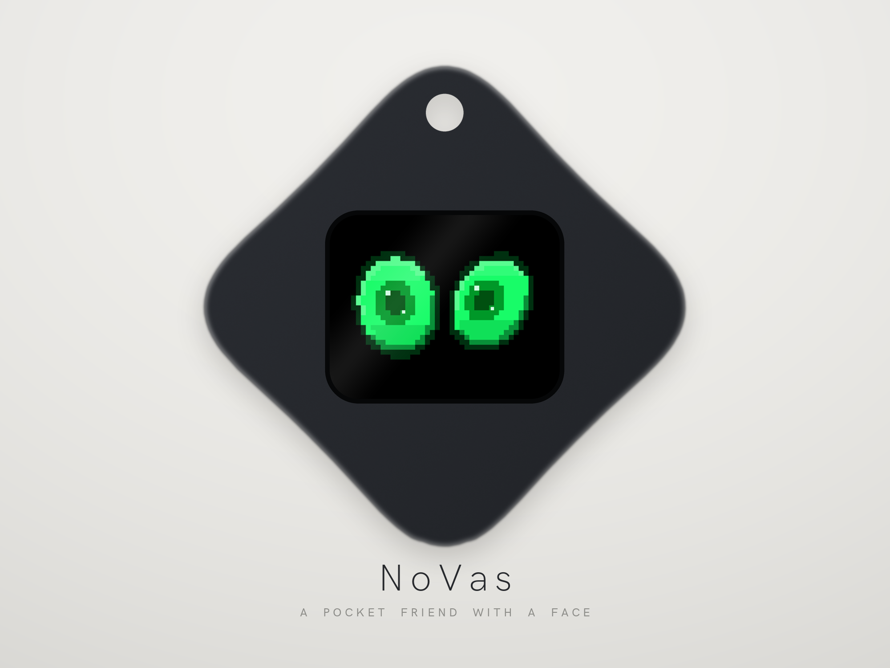
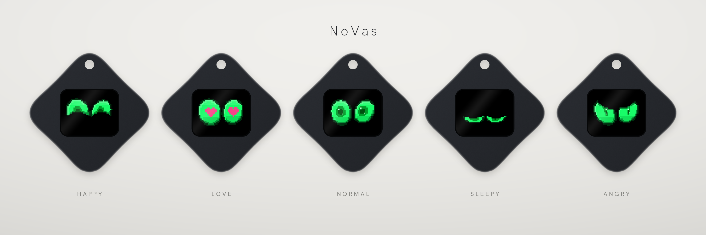
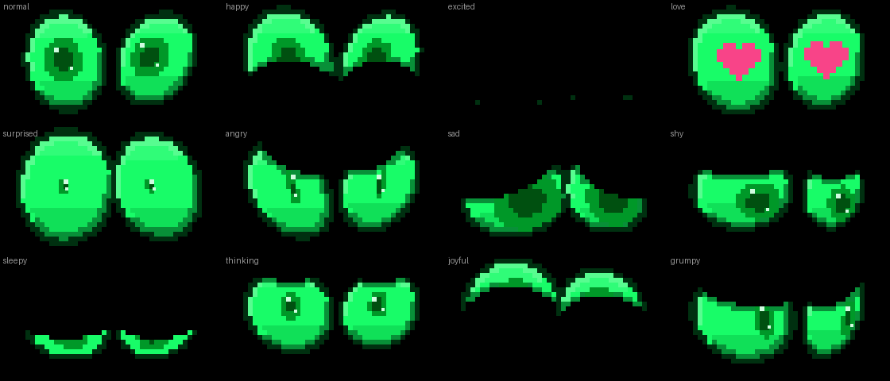
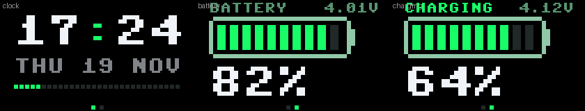

<p align="center"></p>

# NoVas

**A tiny pocket friend with a face.** NoVas is a keychain-sized gadget with a touch screen and a pair of pixel eyes that feel alive. It blinks, looks around, gets curious, gets sleepy, falls in love when you hold it, and answers yes-or-no questions when you shake it. It also tells the time and shows its battery.

Everything here is open: the MicroPython program, the 3D-printable case (and the code that generates it), and the tools I used to make it. You can build your own.





*Every mood, photographed straight from the screen memory: normal, happy, excited, love, surprised, angry, sad, shy, sleepy, thinking, joyful, grumpy.*



---

## What it does

- **Alive eyes.** Soft springs move the eyes and pupils, each eye follows a little late, the pupils dart around by themselves, and the eyelids blink slowly and naturally. Nothing repeats exactly.
- **Moods.** Happy, joyful, excited, love, shy, surprised, sad, angry, grumpy, dizzy, thinking, sleepy and asleep.
- **Pixel look.** Every eye is built from chunky 6-pixel blocks with a soft glow, light-from-the-top-left shading and a shadow under the eyelid. A calm, smooth style is also included.
- **Clock and battery pages.** Swipe left from the face for a big pixel clock, swipe left again for the battery.
- **Charging animation** when you plug it in, and it shows the battery by itself when it is low.
- **Touch and motion.** Tap, double tap, stroke, hold, shake and turn it upside down. Each one does something different.
- **Saves battery.** It gets sleepy when ignored, dims, then turns the screen off. Touch it or pick it up to wake it.
- **Fast.** The pixel eyes run at about 60 frames a second and skip drawing when nothing changes.

## How to use it

| You do this | NoVas does this |
|---|---|
| Tap | Happy, shy, a wink or a perk (never the same twice in a row) |
| Double tap | Excited |
| Tap 4 times quickly | Dizzy, then grumpy (poke it while grumpy and it gets angry) |
| Slide your finger over the screen (stroke it) | Happy, then joyful if you keep going |
| Hold your finger on it | It concentrates harder and harder... then hearts. Let go early and it is a little sad |
| Hold it still, then shake it | The eyes spin and settle on a tick (yes) or a cross (no). Ask it anything |
| Shake it while it is asleep | It just wakes up |
| Turn it upside down | Surprised |
| Swipe left | The clock page. Swipe left again for the battery page. Swipe right or tap to go back |
| Plug in the charger | The charging animation, and a small bolt in the corner while it charges |
| Ignore it | Sad after about 35 s, sleepy after 60 s, asleep after 85 s, screen off after about 2 minutes |

A shake only counts if NoVas was held still for a moment just before it, so a keychain swinging in a bag does not trigger it by accident.

---

## What you need

| Part | Notes |
|---|---|
| [Waveshare ESP32-S3-Touch-LCD-1.69](https://www.waveshare.com/wiki/ESP32-S3-Touch-LCD-1.69) | The brain, screen, touch, motion sensor, clock chip, charger and buzzer all in one. I use the version without a case. |
| LiPo battery, **800 mAh**, about 42.6 x 29.7 x 6.0 mm | Must have the right plug for the board (MX1.25, 2 pin). **Check the polarity before plugging it in.** The red and black wires are swapped on some batteries, and a wrong plug can destroy the board. |
| 3D printer + PETG filament | The case is about 83 x 83 x 22 mm. No screws and no glue. |
| A USB-C cable | To program the board and charge it. |
| A keyring | It goes through the ear on top. |
| A computer with Python 3 | To flash and upload the program. |

## Build your own

### 1. Print the case

The final case is in [`hardware/stl`](hardware/stl). Print `novas_shell.stl` and one back door (see [hardware/README.md](hardware/README.md) for the settings, which door to pick, and how to take the supports out). The door clicks in with two flexible hooks.

### 2. Put MicroPython on the board

NoVas runs on **MicroPython v1.24.1** (`ESP32_GENERIC_S3` build) from [micropython.org/download/ESP32_GENERIC_S3](https://micropython.org/download/ESP32_GENERIC_S3/).

```bash
pip install esptool
# hold the BOOT button while plugging in the USB-C cable, then:
esptool.py --chip esp32s3 erase_flash
esptool.py --chip esp32s3 --baud 460800 write_flash -z 0 ESP32_GENERIC_S3-<date>-v1.24.1.bin   # the file you downloaded
```

### 3. Copy the program to the board

```bash
pip install mpremote mpy-cross==1.24.1.post3
./tools/deploy.sh          # compiles the big files and uploads everything, then restarts the board
```

If your board is not found automatically, give the port: `./tools/deploy.sh /dev/ttyACM0` (Linux) or `/dev/cu.usbmodemXXXX` (macOS).

### 4. Set the clock

```bash
python tools/set_time.py
```

The board has its own clock chip. It keeps counting while the battery stays plugged in. It uses your computer's local time.

### 5. Assemble

1. Plug the battery into the board (check the polarity first).
2. Slide the board into the case from the back, screen against the window.
3. Lay the battery on top and the cable flat beside it.
4. Press the door in until it clicks. To open it later, pry it at the USB-C groove.

---

## Settings

Everything you might want to change is in [`firmware/config.py`](firmware/config.py):

| Setting | What it does |
|---|---|
| `EYE_STYLE` | `"pixel"` for the chunky pixel eyes, `"classic"` for the smooth ones |
| `UI_STYLE` | `"pixel"` or `"smooth"` for the clock and battery pages |
| `CLOCK_24H` | `True` for 14:30, `False` for 2:30 PM |
| `AXES` | How the motion sensor maps to the screen, if it is mounted differently |

More knobs are at the top of `buddy.py` (how fast it gets sleepy, how hard a shake must be, ...), `face.py` (moods, colours, how each mood moves) and `face_px.py` (`G` is the block size of the pixel eyes). Sound is off by default; set `SOUND_ON = True` in `sound.py` for little chirps.

While developing, create an empty file named `dev` on the board. That turns off the watchdog and light sleep so the USB cable keeps working: `mpremote fs touch :dev`.

## How it works

The idea is: *nothing jumps, everything is pulled.* Eyes, pupils, eyelids, size and bounce are all numbers that are pulled toward a target by springs, so they overshoot a little and settle. A mood is just a set of target numbers (how closed the lid is, how high the cheek is, how big the pupil is), and they blend into each other.

| File | What it does |
|---|---|
| `main.py` | Starts Buddy and writes a crash note if anything goes wrong |
| `buddy.py` | The brain: one loop that reads touch, motion and battery, decides the mood and draws |
| `face.py` | All the behaviour: moods, springs, blinking, looking, the yes/no decision, sleep and dreams |
| `face_px.py` | The pixel eyes. A small machine-code routine draws block by block, and unchanged frames are skipped |
| `pen.py` | The smooth eyes: anti-aliased shapes drawn straight into screen memory |
| `ui.py`, `overlay.py` | The clock and battery pages |
| `uifont.py`, `ui_font.bin` | Font pictures for the smooth clock (made by `tools/make_font.py`) |
| `lcd_s3.py`, `touch.py`, `imu.py`, `sound.py` | Drivers for the screen, touch chip, motion sensor and buzzer |

The screen is 240 x 280, turned sideways. Only a 280 x 160 band in the middle is kept in memory (the rest stays black), and only the rows that changed are sent to the screen.

## Make it yours

- **Colour.** Change `GREEN` near the top of `face.py`.
- **Block size.** Change `G` in `face_px.py` (4 gives finer pixels, 8 gives chunkier ones).
- **New mood.** Add a line to `MOODS` in `face.py`: size, how open, lid, cheek, pupil, slant, look-down and colour.
- **New behaviour.** Add a name to `ACTIONS` and a few `self.plan(...)` steps in `begin()`.
- **See your changes.** `tools/capture_gallery.py` takes pictures of every mood straight from the screen memory, and `tools/sheet.py` makes a contact sheet, so you can check a change without a camera.

## Troubleshooting

- **The screen stays dark.** If you ran something over USB, the board may be waiting at its prompt. Unplug the cable for a few seconds, or run `mpremote reset`.
- **It restarts in a loop.** A file on the board has a mistake. Read `crash.log` on the board (`mpremote fs cat :crash.log`) and re-upload.
- **"Clock not set" on the clock page.** Run `python tools/set_time.py`.
- **The eyes follow my finger the wrong way.** Flip `FLIP_X` or `FLIP_Y` at the top of `touch.py`.
- **Out of memory.** The board runs without its extra RAM (PSRAM) enabled, so memory is tight. Keep the big files compiled to `.mpy` (the deploy script does this).

## Not done yet

Ideas I would love help with: NoVas friends that recognise each other over Bluetooth, a pet memory (it remembers how you treat it), more pages. An experiment for showing iPhone notifications is in [`experiments/ios-notifications`](experiments/ios-notifications).

## Credits and licence

- The way NoVas moves was shaped by studying the lovely eye animations of [lilguy.net](https://lilguy.net/) (the "starboy"). NoVas is an independent project with its own code and designs. No assets were copied and it is not affiliated with them.
- The clock font bitmaps come from [Hanken Grotesk](https://github.com/marcologous/hanken-grotesk) (SIL Open Font License 1.1).
- Built on [MicroPython](https://micropython.org/) and the Waveshare ESP32-S3-Touch-LCD-1.69 board.

Code: [MIT](LICENSE). Case designs and the case generator: [CC BY 4.0](hardware/README.md#licence) (share them, just credit NoVas).

Made with care. If you build one, I would love to see it.
